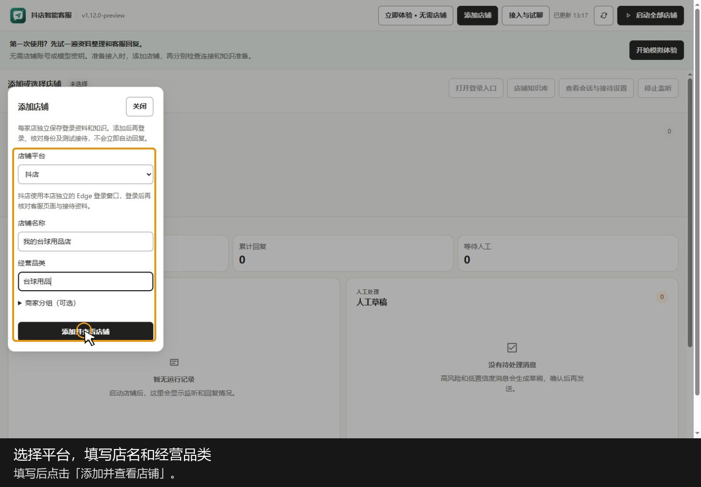

# AI 智能客服

**帮电商卖家回复顾客消息，让老板少守着客服窗口，多花时间打包、发货和经营。**

## 1. 这是一个什么工具

这是一款面向电商卖家的智能客服工具。店铺接入并开启接待后，它会结合商家提供的商品资料、店铺规则和顾客的聊天上下文，自动处理有依据的咨询，承担一部分原本由人工客服完成的回复工作。

## 2. 它解决什么问题

一个人开店，经常要同时管商品、打包发货、回复消息。顾客问价格、库存、材质、什么时候发货，老板就得停下手里的活反复回答；忙起来容易漏消息，临时找人又增加成本。

顾客也不会每次都把话说完整。“这个呢”“前一个还有货吗”等追问，需要联系前面的商品和对话才能答对。工具要做的，就是根据店铺资料和上下文，把这些客服消息接起来。

## 3. 它怎么解决

**先学习商家的资料。** 把商品信息、常见问答、发货规则等资料交给工具，作为回复依据。价格和库存等信息更新后，后续回复使用更新后的资料。

**简单问题直接回复，有歧义的问题结合上下文。** 明确的价格、库存、商品属性等咨询按资料回答；换款、指代和多轮追问会结合前文判断。缺少关键信息时先追问，避免猜答案。

**从接待中积累经验。** 接待记录、历史问答和人工纠正可以整理成可复用的店铺知识。新经验经核对确认后用于后续回复，让同类问题不必反复从头处理。

## 4. 30 秒上手操作教程

[](docs/media/customer-service-demo-30s.mp4?raw=true)

[下载使用教程（MP4，30 秒，操作画面与步骤字幕）](docs/media/customer-service-demo-30s.mp4?raw=true)

直接跟着客户端界面走：添加店铺 → 打开登录入口 → 导入并核对商品资料 → 填写模型连接信息 → 检查本店接待条件 → 从主窗口启动，日常查看人工草稿。

教程使用独立的示例店铺，商品资料导入和启用实际完成。登录、密钥填写、模型连接验证及真实消息收发需店主在自己的环境完成；视频只指示相应入口，没有展示真实店铺已开始自动回复。需要细看时可暂停。

## 5. 适合谁使用

- **一个人兼顾打包、发货和客服的个人卖家**：希望忙着发货时，常见咨询也有人回复。
- **希望减少人工客服成本的电商卖家**：把重复、资料充分的咨询交给工具，人工集中处理售后、复杂判断和需要协商的问题。

## 6. 这个工具能做什么

- **自动回复消息**：在已接入并开启接待的店铺读取新咨询，生成并发送符合资料和接待规则的回复。
- **按商品资料回答**：回复价格、库存、材质、规格、发货规则等有明确依据的问题。
- **联系上下文理解追问**：识别顾客正在问哪个商品，处理换款、指代和多轮补充信息。
- **积累店铺知识**：把历史问答、接待经验和人工纠正整理成可复用内容，经确认后用于后续回复。
- **交给人工接管**：售后、缺少依据或需要店主决定的问题进入人工待办，店主可查看上下文和建议回复。
- **管理多家店铺**：按店铺查看接待状态，分别维护商品资料和会话知识。
- **试聊和纠错**：正式开启前检查回答；发现错误后修改对应资料或答案，再确认后续回复是否正确。

## 7. 怎么开始使用

1. **打开客户端**：完整解压安装包，运行 `FeigeCustomerService.exe`，或打开已安装的“抖店智能客服”。
2. **添加并登录店铺**：点击“添加店铺”，选择平台、填写店名，再从该店的登录入口登录商家账号。
3. **准备回复依据**：进入“店铺知识库”，导入支持格式的商品表、常见问答和店铺规则，核对后启用。商品表支持 JSON / CSV；价格、库存及经营规则应填写本店实际信息。
4. **连接智能理解模型**：在“接入与试聊”的“更多设置与排查”中打开“千问模型设置”，填写自己的模型服务连接信息并验证。
5. **检查后开启接待**：通过“查看会话与接待设置”核对本店身份，用测试顾客确认消息能正常接收和回复，并检查本店的自动发送配置，再从主窗口启动。添加店铺和登录本身不会立即自动回复。
6. **日常查看人工待办与资料变化**：让工具处理有依据的常见咨询；需要人工的消息由店主接手。商品信息变化时更新资料，把已确认的好答案补进知识库。

不同平台的接入进度不同，请以客户端显示的可接待状态为准。正式使用前，需要确认本店消息能正常收发。


<details>
<summary>开发者：源码运行与检查</summary>

## 源码运行

需要 Windows 和 Python 3.10 或更高版本。在项目根目录打开 PowerShell：

```powershell
python -m venv feige-agent/.venv
feige-agent/.venv/Scripts/python.exe -m pip install -r feige-agent/requirements.txt
feige-agent/.venv/Scripts/python.exe feige-agent/desktop_main.py
```

`--lab` 可单独打开试聊与纠错窗口；`--experience` 打开独立模拟体验。客户端的真实接待需完成店铺连接、资料和模型配置。

上传前检查：`python tools/prepare_github_upload.py --check`。

客户端源码位于 `feige-agent/`，商品资料与分类模块位于 `feige-fashion-customer-service/`。本机账号、凭证、会话、浏览器状态和备份不包含在仓库中。

</details>
