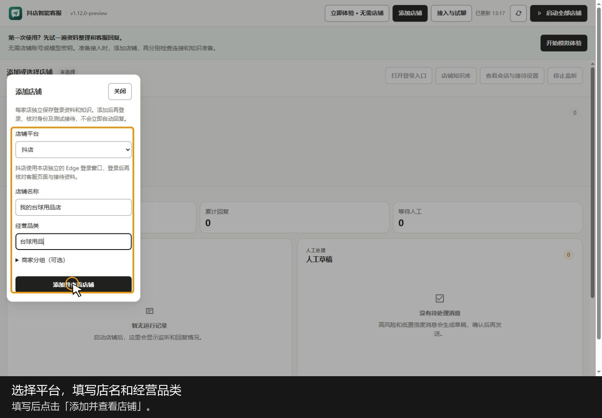

# 社区版 抖店单店体验

**仅支持抖店飞鸽，最多接入 1 家店铺。** 基于原桌面版本裁剪，保留飞鸽登录、消息监听、模型回复、知识库和人工草稿。

[社区版安装与使用](docs/社区版安装与使用.md)

原有说明和教程视频继续保留。历史说明中的多平台、多店铺内容不属于本次社区版范围。

**帮商家回复顾客消息，让一个人开店的老板也能兼顾打包、发货和客服。**

## 1. 这是什么工具

一款面向电商卖家的智能客服工具。接入店铺后，结合商家提供的产品资料和顾客的聊天上下文，自动回复有依据的咨询，代替人工处理一部分客服消息。

## 2. 解决什么问题

老板正在打包发货，顾客消息却不断进来。价格、材质、规格、库存这些问题要反复回答，忙起来容易漏消息；专门雇客服，又增加人力成本。

顾客还经常只说“这个呢”“前一个还有货吗”。要答对，就得知道前面聊了什么、正在问哪个商品，光匹配关键词不够。

## 3. 怎么解决

- **先学习商家资料**：把商品信息、常见问答、发货规则等作为回复依据，简单问题直接按资料回答。
- **结合上下文回复**：联系前面的商品和聊天内容理解追问。遇到歧义先判断，信息不足时向顾客确认，避免猜答案。
- **在接待中积累知识**：把实际接待中的问答、人工处理经验和纠正内容整理下来，经核对确认后用于后续回复，逐步减少重复处理。

例如，顾客先问黑色款，再问白色款，随后问“前一个还有货吗”，工具需要联系前文识别商品，再根据对应资料回答库存。

## 4. 30 秒使用教程

[下载教程（MP4，30 秒）](docs/media/customer-service-demo-30s.mp4?raw=true)

跟着实际界面操作：添加店铺 → 打开登录入口 → 导入商品资料 → 配置模型 → 检查接待条件并启动 → 查看人工草稿。

教程使用示例店铺；资料导入和启用已实际完成。账号登录、密钥填写、模型验证和真实消息收发需店主自行完成，视频未展示真实店铺已开启自动回复。

## 5. 适合谁用

- **个人卖家、一个人开店的老板**：自己既要打包发货，又要回复顾客，希望忙的时候常见咨询也能得到回复。
- **希望减少人力成本的电商卖家**：让工具承担重复咨询，人工集中处理售后、协商和需要判断的问题。

## 6. 有哪些功能

- **自动接待与回复**：在已支持、已配置并开启接待的店铺读取顾客消息，生成并发送回复。
- **学习产品资料**：利用商家提供的价格、库存、材质、规格及店铺规则回答问题。
- **理解多轮对话**：结合上下文处理换款、指代和补充提问，判断顾客具体在问什么。
- **积累店铺知识**：整理接待经验和人工纠正，经确认后复用到后续问答。
- **人工接管**：售后、缺少依据或需要老板决定的问题交给人工，并保留上下文和建议回复。
- **抖店单店接待**：维护本店资料，查看接待状态和待处理消息；社区版最多接入一家店铺。
- **模拟试聊与纠错**：正式接待前试问，发现错误后修正资料或答案，再检查效果。

## 7. 怎么使用

1. **打开客户端，添加店铺**：添加抖店，填写店铺名称和经营品类（社区版限一家）。
2. **登录商家账号**：点击该店的“打开登录入口”，在本店独立 Edge 窗口中完成飞鸽登录。
3. **导入本店资料**：进入“店铺知识库”，在“更多设置与排查”中打开“资料导入、历史版本与回退”，导入支持格式的商品表、问答及规则，核对后启用。商品表支持 JSON / CSV。
4. **配置回复模型**：打开“千问模型设置”，填写自己的模型、接口地址和密钥，启用后保存，并验证连接。
5. **检查并启动接待**：核对店铺身份、平台支持范围和自动发送配置，用测试顾客检查消息收发，确认正常后从主窗口启动店铺。
6. **日常处理人工消息、更新知识**：常见咨询交给工具；查看“人工草稿”处理需要接手的消息。商品信息变化时更新资料，把确认过的处理经验补进知识库。

社区版仅用于一家抖店。首次正式使用前，需确认本店消息能够正常接收和回复。

源码启动方法见 [README 的源码运行说明](README.md#源码运行)。
